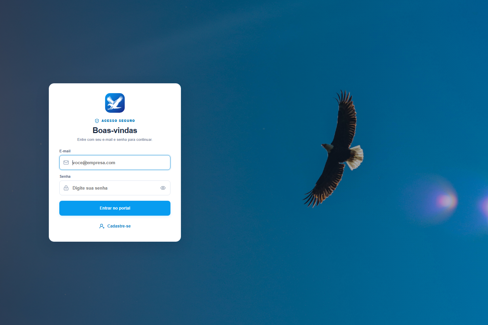

# Águia Gestão — preparação para publicação

## Prévia visual



## Estado atual
- Interface React + TypeScript (Vite), com layout responsivo para celular e computador.
- Configuração PWA: pode ser instalada pelo navegador e abre a interface em cache quando a conexão cai. Os dados e operações exigem internet.
- API FastAPI + SQLAlchemy. O caminho do banco pode ser configurado por `DATABASE_URL`.
- O banco atualmente usado no desenvolvimento fica em `backend/aguia_gestao.db`; preserve esse arquivo ao planejar a migração dos dados existentes.

## Desenvolvimento local
API (terminal 1):
```powershell
cd backend
.\.venv\Scripts\Activate.ps1
uvicorn app.main:app --reload --port 8003
```

Interface (terminal 2):
```powershell
cd frontend
npm run dev
```

A API local fica em `http://127.0.0.1:8003`; Vite roda na porta exibida no terminal.

## Configuração de produção
1. Publique a API em um serviço que mantenha o processo ativo e ofereça armazenamento gerenciado.
2. Use PostgreSQL gerenciado. Instale as dependências do `backend/requirements.txt` e configure `DATABASE_URL` no formato `postgresql+psycopg://...`.
3. Publique o frontend via HTTPS. Se API e interface compartilharem domínio, mantenha `VITE_API_URL=/api` e configure o proxy `/api` para a API. Se estiverem em domínios separados, defina `VITE_API_URL` para a URL completa da API antes do build.
4. Defina `CORS_ORIGINS` no backend com a origem exata da interface, por exemplo `https://gestao.suaempresa.com`.
5. Configure backup automático do PostgreSQL, retenção e procedimento de restauração antes de migrar os clientes cadastrados.
6. Gere a interface com `npm run build` e sirva o conteúdo de `frontend/dist` em HTTPS. Em celulares, abra o endereço e escolha “Adicionar à tela inicial” / “Instalar app”.

## Dados atuais
O SQLite local não é enviado ao navegador nem ao frontend. Faça uma cópia de segurança e planeje a importação para o banco de produção antes de colocar o portal em uso. A inicialização atual cria tabelas e aplica alguns ajustes incrementais; antes de operar em produção, isso deve ser substituído por migrações versionadas.

## Pendências antes de uso oficial
O sistema inclui acesso por login e cadastro de técnicos. Antes de inserir dados reais na internet, revise a autorização de cada operação no backend, prepare migrações versionadas, teste os backups e defina monitoramento e política de acesso aos dados.
